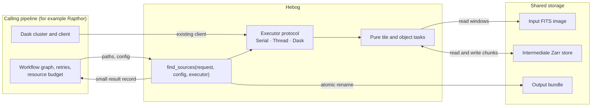
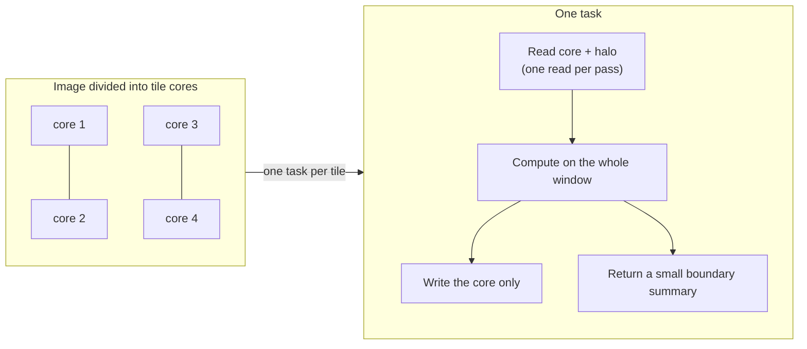
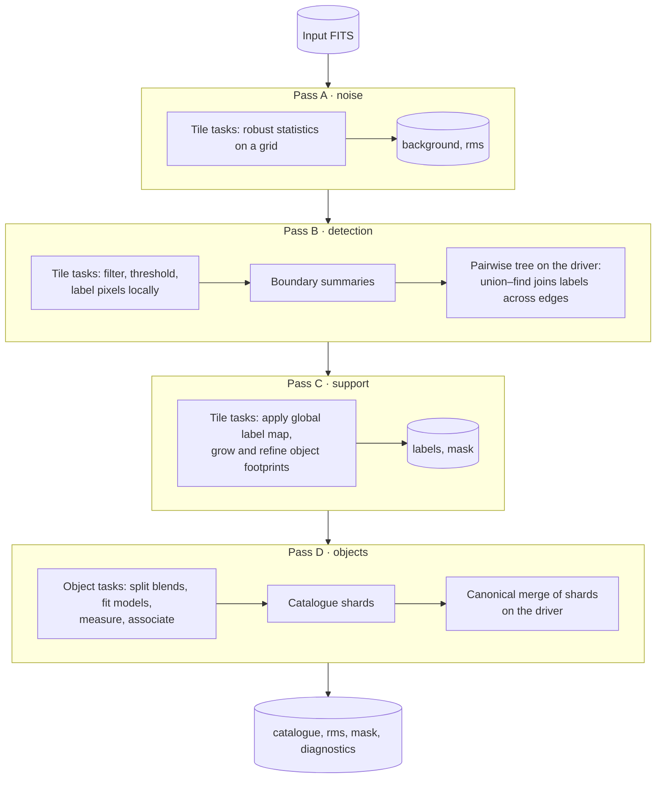

# How Hebog distributes work

This page is for architects and pipeline developers. It explains how Hebog
splits one image into independent tasks, what crosses the network, and which
guarantees hold when the work runs on many machines. It assumes no radio
astronomy background. The decisions behind it are recorded in
[ADR-004](adr/004-keep-top-level-scheduling-in-rapthor.md),
[ADR-005](adr/005-scale-large-images-with-hierarchical-tiles.md),
[ADR-007](adr/007-use-zarr-for-intermediate-image-storage.md) and
[ADR-008](adr/008-make-the-continuum-composition-tile-native.md).

!!! note "Current status"
    Every scientific step runs as tiled tasks through an executor and
    exchanges image planes through Zarr, and the driver holds no image-sized
    plane. Background and RMS estimation tiles on 128-pixel cores; every other
    stage uses 2,048-pixel cores, so 3,000 pixels is the first size that
    reconciles those stages across tiles and 22,500 is an eleven-by-eleven
    grid. The public API admits 22,500 pixels per side, and each larger tier
    is admitted once its traced memory peak and tiled invariance are measured.
    Every task declares the memory it holds, bounded by its tile, halo, batch
    and storage chunk. Two terms of the analysis itself are not yet bounded by
    the tile: an object wider than a task's read budget is reduced on the
    driver from its own pixels (ADR-008), and what the analysis itself holds
    grows with the sources found and the image, which
    `hebog.analysis_memory_bytes` states for the caller to reserve. Scale
    beyond one machine has not been demonstrated.
    [Progress against goals](../reference/progress-against-goals.md#scalability)
    has the figures.

## The problem in one paragraph

A source finder turns an image into a table of objects. Most of the work is
local: the answer for one pixel depends only on pixels within a fixed
distance. A few steps are global: an object can be larger than any fixed
distance, and two detections far apart can belong to the same object. A
100,000 × 100,000 image of 64-bit values is 80 GB per plane, and the pipeline
needs several planes, so no single worker can hold the image. Hebog therefore
makes the local work embarrassingly parallel and reduces the global work to
small records.

## Who owns what



- **The caller owns the cluster.** Hebog never creates a Dask cluster, a
  process pool or a client. The caller passes an executor:
  `SerialExecutor`, `ThreadExecutor`, or `DaskExecutor(client)` wrapping a
  client it already owns.
- **Hebog owns the science.** The same code path runs under every executor.
  `SerialExecutor` is the reference; the others must reproduce its output.
- **Storage carries pixels; the scheduler carries records.** Tasks read
  windows of the input and read or write Zarr chunks. Task arguments and
  results are small serializable records. No image-sized array is sent through
  the scheduler or gathered on the driver, and no task's arguments grow with
  the image: Dask serializes a task's function with every task, so a partition
  manifest pickles as the four pairs its tiles are planned from and is rebuilt
  once per worker process. Before that rule, every 128-pixel background cell's
  task carried a manifest of every cell, and at 10,000² the driver spent more
  CPU on those tasks than the workers spent computing them.

## Tiles, cores and halos

Hebog divides the image into a grid of **tiles**. Each tile has:

- a **core**: the pixels this tile is responsible for. Cores do not overlap
  and together cover the image exactly once; and
- a **halo**: a read-only margin of neighbouring pixels, wide enough for the
  current stage to compute correct values at the core's edge.



Each stage declares the smallest halo that makes its output exact. A
smoothing filter needs a halo as wide as its kernel; labelling connected
pixels needs none, because it reports what touches the edge instead. The
[per-stage contract](adr/008-make-the-continuum-composition-tile-native.md#per-stage-contract)
lists every halo.

Three rules make the result independent of how the image was tiled:

1. **Cores own pixels.** A task writes only its core, so no two tasks write
   the same pixel and no merge of overlapping pixels is needed.
2. **A canonical pixel owns each object.** A detected object belongs to the
   core containing its first pixel in row-major order. Its identifier is a
   hash of that global pixel position, so it does not depend on tile layout,
   worker count or completion order.
3. **Derived grids are anchored to the image, not to the tiles.** Moving the
   tile grid changes which task computes a value, never the value.

A small image is simply one tile with an empty halo. There is no separate
"small image" code path.

## Passes: where the global steps go

The pipeline runs as four **passes**. Within a pass all tile tasks are
independent. A pass ends only where a global reduction must finish before any
later decision can be made.



| Pass | Unit of work | Global step at its end |
| --- | --- | --- |
| A · noise | tile | none; grid cells are disjoint |
| B · detection | tile | join connected regions that cross tile edges |
| C · support | tile, then one object's window | decisions scoped to one object, applied back per tile |
| D · objects | one object's bounding window | group interacting objects, reduce catalogue shards |

### Joining objects across tile edges

A tile labels connected pixels using local integers. It returns the labels
along each edge of its core and, for every label, a few mergeable facts:
pixel count, bounding box, peak, first pixel and whether it holds a detection
seed. A union–find reduction joins labels that meet across an edge, combining
tiles pairwise in a tree fixed by their order, so the result does not depend
on completion order. Today that reduction runs on the driver, which holds
every tile's summaries; it compares each seam once, so its cost grows with
the tiles, and the plan's risks track the summaries the driver keeps. The
resulting global label map is **sharded**:
each tile receives only the entries for labels it contains.

### Objects larger than a halo

From pass C onwards some work is scoped to one object instead of one tile. The
task reads the window that contains the whole object, makes the decision once,
and returns a small record that the tile tasks then apply to the cores they
own; where the decision's pixels are needed, each core derives them again from
its own reads rather than receiving them. The decision therefore cannot depend
on where tile boundaries fall. One declared exception remains: an object wider
than a task's read budget is reduced on the driver from the pixels, or seeds,
its cores return, so that memory grows with the object; ADR-008 bounds it to
the current envelope. Objects that exceed a hard size bound are published as one explicitly
deferred detection instead of consuming unbounded memory.

## The executor contract

Hebog's scientific code depends on a two-member protocol, not on Dask:

```python
class Executor(Protocol):
    @property
    def capacity(self) -> ExecutorCapacity: ...
    def map_batches(self, function, batches, *, requirement=None) -> list: ...
```

All executors obey the same rules, so a defect shows up on a laptop under
`SerialExecutor` rather than only on a cluster:

- Results follow input order, whatever order tasks complete in.
- Payloads must be serializable. Every executor checks this before submitting,
  so a lambda or an open file fails immediately, even serially.
- Submission is bounded by `capacity.maximum_tasks_in_flight`. A
  `TaskRequirement` (memory and threads) narrows that bound and is refused up
  front if one task cannot fit one worker. Every round declares one, as
  described [below](#memory).
- After a failure nothing more is submitted, and the call raises the first
  failing batch's own error only once no task it submitted is still running,
  so none writes into a work directory the caller is removing. Dask cannot
  stop a task a worker has started, so `DaskExecutor` waits for every task
  in flight rather than cancelling it.
- Tasks are idempotent, so a `retry_limit` above zero is safe.

Tasks are **coarse batches** of tiles or objects: an object round puts up to
256 objects in one task, and a tile round up to four tiles. A tile round's
batch shrinks, down to one tile, until the round holds two batches for each
of the executor's task slots, so the nine tiles of a 5,000² image make nine
tasks on four threads rather than tasks of four, four and one tile; the
serial executor keeps four. Graph size therefore scales with the number of
tiles and stages, and in an object round with the number of objects over
that batch size, never with pixels. Objects are batched a storage core at a time, so
at 100,000 pixels a side one object round of the 15,402² mosaic's density
is about 4,700 tasks rather than the 156,000 raster order made.

## Storage

| Data | Format | Why |
| --- | --- | --- |
| Input image | FITS | The community interchange format. Workers read only the window they need. |
| Intermediate planes | Zarr v3 | Chunked, so tasks read and write independent pieces concurrently. One chunk per tile core. It is the only intermediate backend. |
| Published products | FITS and JSON | Compatibility with astronomy tools. Written privately, validated, then moved into place with one atomic rename. |

Only planes that a later pass or a product needs are stored. Filter responses
and other transient arrays stay in task memory. Science planes are `float64`;
a 2,048-pixel core with its halo is about 42 MB per plane, so ten planes of
one core take roughly 420 MB whatever the image size.

On a multi-node cluster, the input image and the parent of the output
directory must be on storage every worker can reach with the same absolute
path.

## Guarantees and how they are tested

| Guarantee | Level | Evidence |
| --- | --- | --- |
| Labels, masks, identifiers, catalogue membership and ordering do not depend on tile shape, partition origin, worker count, task order or retries | exact | contract and partition-invariance tests, including sources placed on tile edges and corners, and the complete public product set of an analytic image from one tile against an eleven-by-eleven grid, the most a 22,500-pixel image runs on, on an image whose last row of tiles is narrower than a filter halo and whose last column ends on a core edge |
| Continuous filter responses agree across tilings | within 2 × 10⁻¹³ | multiscale partition-equivalence tests, with knife-edge threshold cases |
| Serial, thread and Dask execution publish the same products | byte-identical scientific products | the shared executor contract suite; the public product set under each executor, on small tiles, for fitted fields with injected fit failures, high-threshold controls and the eleven-by-eleven grid image above; and one run on Dask workers in separate processes, so that every task's arguments and result are serialized |
| A failed run leaves no partial output, and nothing beside it | — | write-then-rename publication, so the run can be retried with the same request; the contract suite's failure tests, and a public run failing under each executor while another task writes |
| A killed run's staging directory is reclaimed once its owner has provably stopped, and reported otherwise | — | owner-record and lock tests, and a `slow` test in the weekly slow lane that kills the owning process |

## Memory

Every round declares the memory each of its tasks holds, as a
`TaskRequirement`. A task holds what it reads and what it derives per pixel
read, so a round declares its own measured cost per pixel for the largest
window any of its tasks reads: a tile with its halo, or an object batch's
read. Zarr decodes whole chunks, and a store's chunks are its stage's tile
cores, so a read of an intermediate plane counts as at least one chunk. The
costs are the largest traced task peaks on the reference anchors, with a
fixed allowance and a quarter of headroom added. A
declaration is therefore bounded by tile, halo, batch and chunk, and the
public contract suite checks that no task holds more than it declared.

The executor uses the declaration three ways. It refuses a task larger
than a worker admits before submitting anything. It narrows the in-flight
window so that concurrent tasks fit the admitted memory, which is what
bounds a `ThreadExecutor`. And a `DaskExecutor` built with
`memory_resource` and `core_resource` attaches the declared bytes and
threads to every task under those Dask resource names, so Dask starts a
task only on a worker with that much of each still free; the names, and
each worker's amounts, are the caller's. When resources are named, the
workers' declared amounts are also the admitted budget, and a round that
no current worker could run is refused rather than left waiting.

The analysis itself holds Hebog's modules, the records each pass returns
and the background's noise grids, in the process that calls
`find_sources`. The records grow with the sources it finds, about 40 KB
each: the dense ELAIS-N1 central 5,000² held three times what the 10,000²
LoTSS anchor did. The grids grow with the pixels. Neighbouring local-noise
tasks read overlapping windows, so their requests copy the same cells,
about five times the pilot grid in all; they are built and submitted in
rounds of at most 64 MiB, a few hundred tasks each, so the requests do not
grow with the image, at the cost of a drain between rounds on a large
cluster. Built all at once, they made the analysis's peak on the sparse,
finely sampled LOFAR-HD ELAIS-N1 mosaic's central 7,500², where the
analysis held about 3.6 bytes a pixel in all, as on the whole 22,500².
`hebog.analysis_memory_bytes(shape_yx, expected_sources=...)` states it for
the image's shape and an upper estimate of the source count, above the
traced peak between tasks on those anchors, so the caller can reserve it
for the task that calls `find_sources`. `hebog.expected_source_count` makes
that estimate from the image's bright local maxima, in bounded blocks.

## What is not decided here

Hebog does not choose worker counts, memory limits, spill policy or task
placement; those belong to the cluster's owner. It names no Dask resource:
the caller chooses the resource names and each worker's amounts. Tile cores
are fixed per stage today; choosing them from the core budget is planned.
Declarations may change batching and placement, never results.

See [Integrate Hebog into a pipeline](../how-to/integrate-into-a-pipeline.md)
for the practical steps.
